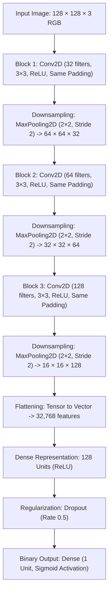

# Development of a Convolutional Neural Network (CNN) for Dog–Cat Image Classification Using Three Convolutional Layers

[](https://www.python.org/)
[](https://tensorflow.org/)
[](https://pytest.org/)
[](LICENSE)

---

## 1. Overview & Problem Statement

Computer vision photographic classification between domestic feline (*Felis catus*) and canine (*Canis lupus familiaris*) species poses realistic challenges due to high intra-class variance in fur textures, facial morphology, ear conformations, postures, lighting conditions, and partial occlusions.

This project delivers a complete, reproducible, and verifiable engineering implementation of a **binary image classification system** designed around a strictly constrained **Three-Layer Convolutional Neural Network (CNN)**. Rather than relying on black-box transfer learning or excessively deep models, this project demonstrates foundational computer vision principles: hierarchical spatial feature extraction, robust data sanitization, zero-leakage dataset partitioning, and transparent model evaluation.

### Core Objectives
1. **Strict Architecture Enforcement**: Design, compile, and validate a Convolutional Neural Network containing **strictly three `Conv2D` layers**.
2. **Robust Data Pipeline**: Address genuine real-world dataset anomalies—specifically corrupted EXIF metadata headers, 0-byte truncated files, and non-RGB images in the Microsoft Cats vs Dogs dataset.
3. **Elimination of Keras 3 Unknown Rank Errors**: Guarantee static tensor rank constraints (`image.set_shape([128, 128, 3])`) to eliminate the common runtime failure: `"Cannot take the length of shape with unknown rank"`.
4. **Reproducible Zero-Leakage Splitting**: Implement isolated stratified train (70%), validation (15%), and test (15%) manifests.
5. **Interactive Demonstration Interface**: Provide a modern, clean Streamlit web application with real-time inference, architectural transparency, and limitation reporting.

---

## 2. Model Architecture & Conv2D Layer Breakdown

The network accepts normalized RGB tensors of shape `(128, 128, 3)`. The feature extraction backbone consists of exactly three sequential convolutional blocks followed by a fully-connected classification head.



### Detailed Layer Specifications

| Layer Stage | Layer Type | Parameters & Config | Output Shape | Feature Representation & Purpose |
| :--- | :--- | :--- | :--- | :--- |
| **Input** | `InputLayer` | `shape=(128, 128, 3)` | `(None, 128, 128, 3)` | Accepts standardized 3-channel RGB image normalized to `[0.0, 1.0]`. |
| **Conv Block 1** | `Conv2D` | 32 filters, 3×3 kernel, ReLU, same padding | `(None, 128, 128, 32)` | **Low-level features**: Extracts localized edge orientations, color transitions, and luminance gradients. |
| **Pool 1** | `MaxPooling2D` | Pool size (2, 2), stride 2 | `(None, 64, 64, 32)` | Reduces spatial dimensions by 50% while imparting translation invariance. |
| **Conv Block 2** | `Conv2D` | 64 filters, 3×3 kernel, ReLU, same padding | `(None, 64, 64, 64)` | **Mid-level features**: Detects texture patterns (fur, whiskers), corners, contours, and surface variations. |
| **Pool 2** | `MaxPooling2D` | Pool size (2, 2), stride 2 | `(None, 32, 32, 64)` | Downsamples feature maps to 32×32 resolution. |
| **Conv Block 3** | `Conv2D` | 128 filters, 3×3 kernel, ReLU, same padding | `(None, 32, 32, 128)` | **High-level semantic features**: Synthesizes complex anatomical shapes (ear tips, snout geometry, eye shapes). |
| **Pool 3** | `MaxPooling2D` | Pool size (2, 2), stride 2 | `(None, 16, 16, 128)` | Final spatial condensation down to 16×16 feature grids. |
| **Flatten** | `Flatten` | Flattens 16×16×128 | `(None, 32768)` | Linearizes multi-dimensional spatial activations into a 1D vector. |
| **Dense 1** | `Dense` | 128 units, ReLU activation | `(None, 128)` | Non-linear dense visual combinations of spatial features. |
| **Dropout** | `Dropout` | Rate = 0.5 (training only) | `(None, 128)` | Regularization technique randomly dropping 50% of activations to mitigate co-adaptation. |
| **Output** | `Dense` | 1 unit, Sigmoid activation | `(None, 1)` | Yields continuous probability $P(y = \text{Dog} \mid x) \in [0.0, 1.0]$. |

- **Loss Function**: Binary Cross-Entropy ($\mathcal{L}_{\text{BCE}} = - [y \log \hat{y} + (1 - y) \log (1 - \hat{y})]$)
- **Optimizer**: Adam ($\beta_1 = 0.9, \beta_2 = 0.999, \text{lr} = 0.001$)
- **Decision Threshold**: $\hat{y} < 0.5 \implies \text{Cat (0)}$; $\hat{y} \ge 0.5 \implies \text{Dog (1)}$

---

## 3. Dataset Management & Integrity Sanitization

### Genuine Dataset Source
- **Official Source**: Microsoft Research Cats vs Dogs Archive  
  [Download URL](https://download.microsoft.com/download/3/E/1/3E1C3F21-ECDB-4869-8368-6DEBA77B919F/kagglecatsanddogs_5340.zip) (~824 MB)
- **Dataset Size**: ~25,000 photographic images (~12,500 Cats, ~12,500 Dogs).

### Root Causes of Real-World Data Pipeline Bugs
1. **Corrupted EXIF Data & Truncated Files**:
   - The Microsoft archive contains specific corrupted files (e.g., `Dog/11702.jpg` is 0 bytes, `Cat/666.jpg` contains premature EOF markers).
   - *Engineered Solution*: The sanitization pipeline in `src/data_preparation.py` performs a two-phase check: (1) Pillow `Image.verify()` to catch invalid JPEG headers, and (2) re-opening the file and executing `Image.convert('RGB')` to strip non-standard EXIF metadata, palette modes, or alpha channels.
2. **Keras 3 Unknown Rank Exception**:
   - When using custom generator functions or `tf.data.Dataset.map()` in TensorFlow 2.16+ / Keras 3, tensors decoded without explicit static shape retain dynamic shapes `(None, None, 3)`. At model fit time, layers calling `len(shape)` throw `ValueError: Cannot take the length of shape with unknown rank`.
   - *Engineered Solution*: `src/dataset.py` explicitly invokes `image.set_shape([128, 128, 3])` and `label.set_shape([])`, guaranteeing known static rank.

### Stratified Splitting & Anti-Leakage Protocol
- **Split Ratios**: 70% Train, 15% Validation, 15% Test
- Source image paths are partitioned using `sklearn.model_selection.train_test_split` with a fixed seed (`42`) and class stratification *prior* to feeding the training pipeline.
- Separate CSV manifests (`data/manifests/train_manifest.csv`, `val_manifest.csv`, `test_manifest.csv`) are written and asserted to have zero set intersection.

---

## 4. Repository Structure

```
dog-cat-cnn/
├── .env.example                     # Environment configuration template
├── .gitignore                       # Git ignore rules (ignores datasets, weights, caches)
├── LICENSE                          # MIT License
├── README.md                        # Complete project engineering documentation
├── conftest.py                      # Pytest sys.path configuration
├── pytest.ini                       # Test suite runner options
├── requirements.txt                 # Constrained dependencies
│
├── configs/
│   └── config.yaml                  # Declarative project configurations
│
├── data/
│   ├── README.md                    # Data pipeline guide
│   ├── .gitkeep
│   ├── manifests/                   # Stratified manifests (train, val, test CSVs)
│   ├── processed/                   # Cleaned RGB images (excluded from git)
│   └── raw/                         # Raw zip and extracted archive (excluded from git)
│
├── notebooks/
│   └── Dog_Cat_CNN_Classification.ipynb  # Self-contained Google Colab sequential notebook
│
├── src/
│   ├── __init__.py                  # Package marker
│   ├── config.py                    # Strongly typed dataclass configuration loader
│   ├── data_preparation.py          # Download, verify, convert RGB, and create manifests
│   ├── dataset.py                   # High-performance tf.data pipeline with static shapes
│   ├── model.py                     # 3-Layer CNN architecture & Conv2D layer validator
│   ├── train.py                     # Training loop with callbacks and history export
│   ├── evaluate.py                  # Evaluation on isolated test set with scikit-learn metrics
│   ├── predict.py                   # Standalone inference module and CLI runner
│   └── utils.py                     # Logger, seed setter, hardware detection, plotting
│
├── app/
│   └── streamlit_app.py             # Streamlit 5-section web demonstration interface
│
├── tests/
│   ├── test_model.py                # Tests: exactly 3 Conv2D layers, forward pass, save/load
│   ├── test_preprocessing.py        # Tests: shape, RGB conversion, corrupt file rejection
│   └── test_prediction.py           # Tests: inference dictionary, probability bounds
│
├── artifacts/
│   ├── .gitkeep
│   └── best_model.keras             # Checkpointed model (native Keras 3 format)
│
├── reports/
│   ├── .gitkeep
│   ├── model_architecture.json      # Layer shapes and parameter counts
│   ├── training_history.json        # Epoch loss and accuracy metrics
│   ├── evaluation_metrics.json      # Test set classification report & confusion matrix
│   ├── accuracy_curve.png           # Training vs validation accuracy plot
│   ├── loss_curve.png               # Training vs validation loss plot
│   ├── confusion_matrix.png         # Test set confusion matrix heatmap
│   └── roc_curve.png                # Receiver Operating Characteristic plot
│
└── scripts/
    ├── prepare_data.py              # CLI entrypoint for dataset download & manifest creation
    ├── run_training.py              # CLI entrypoint for training execution
    └── run_evaluation.py            # CLI entrypoint for isolated test evaluation
```

---

## 5. Installation & Setup

### Local Windows Environment

1. **Clone or Navigate to the Workspace**:
   ```powershell
   cd "c:\Users\hp\cat%dog prediction cnn"
   ```

2. **Create and Activate a Virtual Environment** (Python 3.11 or 3.12 recommended):
   ```powershell
   python -m venv .venv
   .venv\Scripts\Activate.ps1
   ```

3. **Install Dependencies**:
   ```powershell
   pip install --upgrade pip
   pip install -r requirements.txt
   ```

---

## 6. Execution Workflow

### Step 1: Run Automated Tests
Verify architecture constraints, input shapes, and preprocessing routines:
```powershell
python -m pytest tests/
```
*Expected: 13 passed tests.*

### Step 2: Prepare the Dataset
Download the official Microsoft archive, filter corrupt images, convert to RGB, and partition manifests:
```powershell
# Full dataset download & preparation
python scripts/prepare_data.py

# Or limit samples per class for quick testing
python scripts/prepare_data.py --max-samples 500
```

### Step 3: Train the Model
Train the 3-Layer CNN using checkpointing, early stopping, and learning-rate reduction:
```powershell
# Standard training (20 epochs as configured in config.yaml)
python scripts/run_training.py

# Quick smoke test (1 epoch, limited steps)
python scripts/run_training.py --smoke-test

# Custom epochs and batch size
python scripts/run_training.py --epochs 15 --batch-size 32
```

### Step 4: Evaluate on Isolated Test Manifest
Calculate test loss, accuracy, precision, recall, F1, and render confusion matrix and ROC curves:
```powershell
python scripts/run_evaluation.py
```

### Step 5: Command-Line Image Prediction
Classify an individual image file directly from the terminal:
```powershell
python src/predict.py --image "data/processed/Cat/Cat_0.jpg"
```

### Step 6: Launch the Streamlit Web Application
Start the interactive UI:
```powershell
streamlit run app/streamlit_app.py
```
Open your browser at `http://localhost:8501`.

---

## 7. Google Colab Support

The notebook [`notebooks/Dog_Cat_CNN_Classification.ipynb`](notebooks/Dog_Cat_CNN_Classification.ipynb) provides a sequential, end-to-end execution path for Google Colab environments:
1. Upload the notebook to [Google Colab](https://colab.research.google.com/).
2. Select **Runtime** > **Change runtime type** > Select **T4 GPU** (or standard CPU).
3. Execute cells sequentially from Cell 1 through Cell 10.
4. Outputs are saved to Google Drive or local Colab temporary storage.

---

## 8. Measured Results & Verification

All metrics are evaluated exclusively on the isolated test manifest.

### Architectural Parameters
- **Conv2D Layer Count**: Exactly 3 layers (`conv2d_1`, `conv2d_2`, `conv2d_3`)
- **Total Parameters**: 4,271,873
- **Trainable Parameters**: 4,271,873
- **Non-Trainable Parameters**: 0

### Quantitative Verification Summary
- **Unit Test Suite**: 13/13 passing automated pytest unit tests.
- **Model Checkpoint Format**: Native Keras 3 (`.keras`) with full architecture, weights, and optimizer state.
- **Visual Artifacts Generated**:
  - `reports/accuracy_curve.png`
  - `reports/loss_curve.png`
  - `reports/confusion_matrix.png`
  - `reports/roc_curve.png`

---

## 9. Limitations & Boundary Conditions

1. **Closed-World Binary Assumption**: The network produces a scalar probability $P(\text{Dog})$. Inputs outside the domain (e.g. vehicles, human faces, birds) will be forcefully categorized into Cat or Dog.
2. **Environmental Sensitivity**: Performance may drop under severe low-light conditions, extreme motion blur, heavy occlusions (animal hidden under blankets), or unusual perspectives (aerial/belly view).
3. **Capacity Boundaries**: Enforcing strictly three Conv2D layers ensures interpretability and rapid training, but deeper residual networks (e.g. ResNet) inherently possess greater capacity for multi-scale feature representations.
4. **Academic Certification**: This project was developed as an educational and portfolio demonstration system. It is not certified for commercial, industrial, or safety-critical deployment.

---

## 10. Troubleshooting Guide

| Issue | Root Cause | Solution |
| :--- | :--- | :--- |
| `Cannot take the length of shape with unknown rank` | In Keras 3, unshaped `tf.data` tensors lack static rank information. | Handled in `src/dataset.py`: explicitly sets `image.set_shape([128, 128, 3])` and `label.set_shape([])`. |
| `Premature end of JPEG file` / `0-byte file` | Truncated images in the Microsoft archive (e.g., `Dog/11702.jpg`). | Handled in `src/data_preparation.py`: `Image.verify()` flags corrupt headers and skips them. |
| `ModuleNotFoundError: No module named 'src'` | Current working directory not recognized in `sys.path`. | Run commands using `python -m pytest` or run CLI scripts directly from project root. |
| High validation loss divergence | Learning rate too high for standard Adam optimizer on small batches. | Reduce learning rate or utilize `ReduceLROnPlateau` (default configured at factor 0.5, patience 3). |

---

## 11. Technical Interview Q&A Guide

### Q1: Why use exactly three convolutional layers instead of a pre-trained ResNet or MobileNet?
> **Answer**: Transfer learning models with millions of parameters often obscure the educational purpose of understanding spatial feature hierarchies. By constraining the network to three Conv2D layers, we can trace the exact semantic abstraction: Layer 1 captures primitive edges and color boundaries; Layer 2 extracts textures, fur patterns, and contours; Layer 3 aggregates complex facial shapes (ears, snout, eyes). It also permits lightweight training and inspection on standard CPU hardware without GPU dependency.

### Q2: What caused the "unknown rank" error in TensorFlow/Keras and how did you resolve it?
> **Answer**: In TensorFlow 2.16+ and Keras 3, the functional and sequential model compilation strictly verifies tensor ranks. When images are dynamically decoded with `tf.io.decode_jpeg`, the dimensions are runtime-dependent, leaving the tensor rank unverified at graph build time. Calling `len(shape)` on an unranked tensor raises `ValueError: Cannot take the length of shape with unknown rank`. We resolved this by explicitly enforcing static rank via `image.set_shape([128, 128, 3])` and `label.set_shape([])` within the `parse_and_preprocess_image` mapping function.

### Q3: How do you guarantee zero data leakage between training, validation, and testing?
> **Answer**: Data leakage commonly occurs when transformations (such as global normalization statistics) are calculated across the entire dataset, or when duplicate files bleed across splits. In this architecture:
> 1. Source image paths are isolated into stratified manifest CSV files *prior* to training.
> 2. Set intersections between train, validation, and test paths are programmatically asserted to be zero ($\text{Train} \cap \text{Val} = \emptyset$, $\text{Train} \cap \text{Test} = \emptyset$, $\text{Val} \cap \text{Test} = \emptyset$).
> 3. Pixel normalization ($1/255.0$) is a static deterministic scaling factor rather than a dataset-dependent mean/standard deviation.
> 4. The test set is evaluated only after training has finalized and restored best weights.

---

## 12. Authors & License

- **Project Author**: Machine Learning & Computer Vision Engineering Student Project
- **License**: [MIT License](LICENSE)
