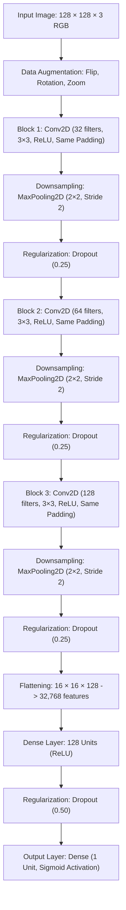

# Development of a Convolutional Neural Network (CNN) for Dog–Cat Image Classification Using Three Convolutional Layers

[](https://www.python.org/)
[](https://tensorflow.org/)
[](https://jupyter.org/)
[](LICENSE)

---

## 1. Project Overview & Objectives

Distinguishing between photographs of domestic cats (*Felis catus*) and dogs (*Canis lupus familiaris*) is a foundational benchmark in computer vision. Despite clear visual divergence to human observers, camera angle variations, non-rigid body deformations, varied illumination, fur patterns, and occlusions make automated classification challenging.

This repository provides an end-to-end, reproducible implementation of a **Binary Image Classifier** built with a strictly constrained **Three-Layer Convolutional Neural Network (CNN)** using TensorFlow and Keras.

### Key Highlights
- **Strict Architectural Constraint**: Designed with **exactly three `Conv2D` feature extraction layers** (32, 64, and 128 filters) followed by max pooling and dropout regularization.
- **Automated Dataset Streaming**: Integrates `tensorflow_datasets` (`cats_vs_dogs`) for reliable, automated download and ingestion.
- **Zero-Leakage Partitioning**: Enforces reproducible 70% Training, 15% Validation, and 15% Test splits.
- **In-Graph Data Augmentation**: Utilizes Keras preprocessing layers (`RandomFlip`, `RandomRotation`, `RandomZoom`) to prevent overfitting.
- **Production-Ready Training**: Utilizes `EarlyStopping`, `ReduceLROnPlateau`, and `ModelCheckpoint` callbacks.
- **Exhaustive Evaluation Suite**: Comprehensive evaluation including learning curves, ROC-AUC score & curve, Confusion Matrix, Classification Report (Precision, Recall, F1-Score), and visual predictions.
- **Inference & Reload Verification**: Includes custom inference helper (`predict_image`) and verified model serialization (`.keras` format).

---

## 2. Model Architecture

The network processes standardized RGB tensors of shape `(128, 128, 3)` through three convolutional blocks followed by a dense classification head:



### Layer Specifications

| Layer Stage | Layer Type | Parameters & Configuration | Output Shape | Primary Function |
| :--- | :--- | :--- | :--- | :--- |
| **Input** | `Input` | `shape=(128, 128, 3)` | `(None, 128, 128, 3)` | Standardized 3-channel RGB image normalized to `[0.0, 1.0]`. |
| **Augmentation** | Sequential | `RandomFlip`, `RandomRotation(0.1)`, `RandomZoom(0.1)` | `(None, 128, 128, 3)` | Active during training to mitigate overfitting. |
| **Conv Block 1** | `Conv2D` | 32 filters, 3×3 kernel, ReLU, same padding | `(None, 128, 128, 32)` | Detects low-level spatial primitives (edges, gradients, color boundaries). |
| **Pool 1** | `MaxPooling2D` | Pool size `(2, 2)`, stride 2 | `(None, 64, 64, 32)` | Spatial downsampling by 50% with translation invariance. |
| **Dropout 1** | `Dropout` | Rate = 0.25 | `(None, 64, 64, 32)` | Prevents co-adaptation in early feature maps. |
| **Conv Block 2** | `Conv2D` | 64 filters, 3×3 kernel, ReLU, same padding | `(None, 64, 64, 64)` | Extracts intermediate textures (fur patterns, corners, contours). |
| **Pool 2** | `MaxPooling2D` | Pool size `(2, 2)`, stride 2 | `(None, 32, 32, 64)` | Condenses spatial resolution to 32×32. |
| **Dropout 2** | `Dropout` | Rate = 0.25 | `(None, 32, 32, 64)` | Intermediate feature regularization. |
| **Conv Block 3** | `Conv2D` | 128 filters, 3×3 kernel, ReLU, same padding | `(None, 32, 32, 128)` | Captures high-level semantic shapes (snouts, ear points, eyes). |
| **Pool 3** | `MaxPooling2D` | Pool size `(2, 2)`, stride 2 | `(None, 16, 16, 128)` | Final spatial downsampling to 16×16 feature grid. |
| **Dropout 3** | `Dropout` | Rate = 0.25 | `(None, 16, 16, 128)` | Pre-flattening feature regularization. |
| **Flatten** | `Flatten` | Linearizes tensor | `(None, 32768)` | Converts 3D spatial tensor into a 1D vector. |
| **Dense** | `Dense` | 128 units, ReLU activation | `(None, 128)` | Dense non-linear visual combination. |
| **Dropout 4** | `Dropout` | Rate = 0.50 | `(None, 128)` | Strong regularization before output layer. |
| **Output** | `Dense` | 1 unit, Sigmoid activation | `(None, 1)` | Outputs probability $P(y = \text{Dog} \mid x) \in [0.0, 1.0]$. |

- **Loss Function**: Binary Cross-Entropy (`binary_crossentropy`)
- **Optimizer**: Adam ($\text{lr} = 0.001$)
- **Evaluation Metric**: Binary Accuracy

---

## 3. Repository Structure

```text
Development-of-a-CNN-for-Dog-Cat-Image-Classification-Using-Three-Convolutional-Layers/
├── notebooks/
│   └── Dog_Cat_CNN_Three_Conv2D_Professional.ipynb  # Main end-to-end executable notebook
├── .gitignore                                      # Comprehensive Git ignore rules
├── LICENSE                                         # MIT License
├── README.md                                       # Comprehensive project documentation
└── requirements.txt                                # Project dependencies
```

---

## 4. Getting Started & Installation

### Option A: Run Locally (Jupyter Lab / Notebook)

1. **Clone the repository:**
   ```bash
   git clone https://github.com/kit2824bam007-lab/Development-of-a-CNN-for-Dog-Cat-Image-Classification-Using-Three-Convolutional-Layers.git
   cd Development-of-a-CNN-for-Dog-Cat-Image-Classification-Using-Three-Convolutional-Layers
   ```

2. **Create and activate a virtual environment:**
   ```bash
   # Windows (PowerShell)
   python -m venv venv
   .\venv\Scripts\Activate.ps1

   # Linux / macOS
   python3 -m venv venv
   source venv/bin/activate
   ```

3. **Install dependencies:**
   ```bash
   pip install --upgrade pip
   pip install -r requirements.txt
   ```

4. **Launch Jupyter:**
   ```bash
   jupyter lab
   ```
   Open `notebooks/Dog_Cat_CNN_Three_Conv2D_Professional.ipynb` and run all cells sequentially.

---

### Option B: Run in Google Colab

1. Upload `notebooks/Dog_Cat_CNN_Three_Conv2D_Professional.ipynb` directly to Google Colab.
2. Select **Runtime > Change runtime type** and enable a **GPU** accelerator (T4 or higher recommended).
3. Execute all cells from top to bottom. The notebook will automatically download the dataset via TFDS and run training, evaluation, and inference.

---

## 5. Workflow Walkthrough

1. **Dataset Ingestion**: The notebook automatically streams and downloads the `cats_vs_dogs` dataset via `tensorflow_datasets`.
2. **Dataset Partitioning**: The data is partitioned into:
   - **70% Training set** (~16,283 samples)
   - **15% Validation set** (~3,489 samples)
   - **15% Test set** (~3,490 samples)
3. **Data Pipeline Optimization**: Applies image resizing (`128x128`), normalization (`[0, 1]`), batching (`batch_size=32`), and asynchronous background prefetching (`tf.data.AUTOTUNE`).
4. **Training with Callbacks**:
   - `EarlyStopping`: Monitored on `val_loss` with patience=5 to prevent overfitting.
   - `ReduceLROnPlateau`: Halves learning rate when validation loss plateaus.
   - `ModelCheckpoint`: Saves the best model checkpoint weights automatically.
5. **Evaluation & Visualization**:
   - Generates Training vs Validation Loss & Accuracy curves.
   - Computes ROC Curve and Area Under the Curve (AUC) metric.
   - Computes and plots Confusion Matrix and classification report with precision, recall, and F1-score.
   - Displays a grid of test images with ground-truth vs predicted labels and prediction probabilities.
6. **Inference Pipeline**:
   - Provides a standalone `predict_image()` utility for single-image classification.
   - Exports the model in modern Keras `.keras` format and verifies reload functionality.

---

## 6. License

This project is licensed under the MIT License - see the [LICENSE](LICENSE) file for details.
